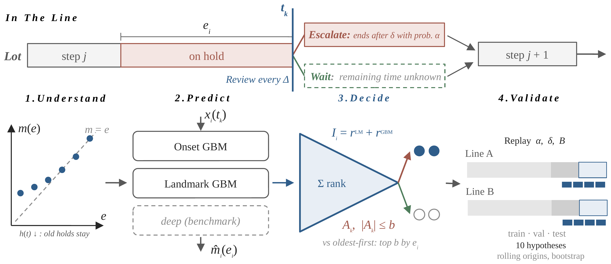

# hold-escalation

Survival analysis of lot holds and a budgeted escalation index for semiconductor
manufacturing lines.

Companion code for

> Surahman, D., and Y.-M. Hsieh. *When should a lot hold be escalated? Survival analysis
> and a budgeted escalation index for a semiconductor bumping line.* Submitted to the
> International Journal of Production Research.



## What the code does

| Step | Module | Output |
|---|---|---|
| Load MES hold events and map them to a neutral schema | `holdesc.io` | – |
| Anonymise codes, hash lot IDs, shift calendar time | `holdesc.anonymize` | – |
| Features at hold onset and at landmark times (no look-ahead) | `holdesc.features` | – |
| Hazard and mean residual life | `holdesc.survival` | Tables 2–3, Figure 2 |
| Onset models: Kaplan–Meier, Cox PH, log-normal AFT, XGBoost AFT, LightGBM | `holdesc.survival` | Table 4 |
| Landmark model of the remaining hold time | `holdesc.landmark` | Table 4, Figure 3 |
| Escalation index, due-date urgency, replay with a daily budget | `holdesc.policy` | Tables 5–6, Figure 4 |
| Bootstrap CIs (lots for discrimination, weeks for policies), Weibull shape | `holdesc.evaluate`, `holdesc.survival` | Tables 2, 4, 5 |
| Framework diagram (legacy v1.x drawing) | `holdesc.framework_figure` | — (paper Figure 1: `figures/figure1_framework.pptx`) |

## Quick start (synthetic data)

```bash
pip install -r requirements.txt
python scripts/make_synthetic.py --out data/synthetic --holds 20000
python scripts/run_pipeline.py --config config/synthetic.yaml --out results_synthetic
```

The run takes a few minutes on a laptop. The synthetic data reproduce the structure of
the study data, not its values, so the synthetic results differ from the paper.

## Running on your own MES data

1. Export the hold transactions of the lots of the line you study (one row per hold,
   with start and release time) and, optionally, the completion time and customer due
   date of each lot.
2. Copy `config/schema.example.yaml` to `config/local.yaml` and map your column names.
   `config/local.yaml` and `data/` are git-ignored.
3. Set a private salt for the lot-ID hash: `export HOLDESC_SALT=<random string>`.
4. Run `python scripts/run_pipeline.py --config config/local.yaml --out results`.

## Confidentiality

The study data are confidential and are **not** part of this repository. The code is
written so that no company information can leave the machine where it runs:

* no plant-specific column name, code, path, or identifier appears in the code;
  all of them live in the git-ignored `config/local.yaml`;
* department, reason, step, product, and lot-type codes are replaced by rank-ordered
  labels (D1, R01, S001, ...) before any analysis; the code-to-label key stays in memory;
* lot IDs are replaced by salted hashes, and calendar time is shifted by whole weeks;
* `results*/` and `data/` are git-ignored;
* `tools/check_confidentiality.py` blocks a commit that contains data files, absolute
  paths, e-mail or IP addresses, compact timestamps, or any term listed in the
  git-ignored file `.confidential_terms` (company, customer, plant, tool, and internal
  code names; one per line).

Install the check as a pre-commit hook:

```bash
cp tools/pre-commit .git/hooks/pre-commit && chmod +x .git/hooks/pre-commit
```

## Figures

* Figure 1 (framework) is an editable PowerPoint drawing: `figures/figure1_framework.pptx` (preview `figures/figure1_framework.png`).
* Figures 2–4 and all tables are rebuilt from the aggregated results by `scripts/make_paper.py`
  (see *Reproducing the paper*). If your own config uses other line names, set
  `HOLDESC_LINE_ALIAS="<name1>=A,<name2>=B"` before running it.
* `scripts/make_figures.py` is kept for the v1.x pipeline only.

All figures are saved as 600-dpi PNG and as vector PDF.

## Outputs of `run_pipeline.py`

| File | Content |
|---|---|
| `table2_departments.csv` | durations by department, Weibull shape with 95% CI |
| `table3_residual_life.csv` | remaining hold time by elapsed time |
| `table4_landmark_metrics.csv` | C-index, AUC and top-10% capture at each landmark |
| `table4_pooled_ci.csv`, `table4_pooled_differences.csv` | pooled metrics with lot-bootstrap CIs and paired model differences |
| `table5_policies.csv` | recovered hold hours, lateness removed, block-bootstrap CIs vs age |
| `table6_sensitivity.csv` | sensitivity to the escalation effect (α, δ) |
| `summary.json` | data summary, onset C-indices, Weibull shape, feature importance |
| `figure2-4*.png/pdf` | result figures |

## Citation

See `CITATION.cff`. Please cite the paper and the archived software version (Zenodo DOI).

## Licence

MIT, see `LICENSE`.

## Reproducing the paper

Every table and figure of the paper can be rebuilt with one command. The production data are confidential and are
not part of this repository; what is archived here are the **aggregated results** of the runs on the two production
lines (`paper_results/`, no hold-level records, codes anonymised, no dates).

```bash
pip install -r requirements.txt                 # + requirements-dl.txt for the deep models (PyTorch)
bash reproduce_paper.sh                         # tables and figures from paper_results/  (Windows: .\reproduce_paper.ps1)
bash reproduce_paper.sh synthetic               # the whole pipeline on two synthetic lines
bash reproduce_paper.sh own <config A> <config B>   # the whole pipeline on your own MES export
```

| Paper | Produced by | File in `paper_output/` |
|---|---|---|
| Figure 1 (framework) | editable PowerPoint drawing | `figures/figure1_framework.{pptx,png}` (in `figures/`) |
| Table 1 (positioning), Table 3 (hypotheses) | text tables | `paper/table1_positioning.md`, `paper/table3_hypotheses.md` |
| Table 2 (data of the lines) | `run_hypotheses.py` → `make_paper.py` | `tables/table2_lines.{csv,md}` |
| Table 4 (prediction, H3) | `run_hypotheses.py` → `make_paper.py` | `tables/table4_prediction.{csv,md}` |
| Table 5 (policies, rolling origins, pooled; H4, H5, H9) | `run_hypotheses.py` → `make_paper.py` | `tables/table5_policies.{csv,md}` |
| Table 6 (H6–H8, H10, flexible budget) | `run_hypotheses.py`, `run_benchmark.py` → `make_paper.py` | `tables/table6_robustness.{csv,md}` |
| Figure 2 (concentration of hold hours, remaining time vs elapsed time; H1–H2) | `run_hypotheses.py` → `make_paper.py` | `figures/figure2_concentration_residual_life.{png,pdf}` |
| Figure 3 (policies as % of the oracle, incl. transferred models; H4, H5, H8) | `run_hypotheses.py` → `make_paper.py` | `figures/figure3_policies_vs_oracle.{png,pdf}` |
| Figure 4 (GBM vs deep-learning benchmark) | `run_benchmark.py` (per line) → `make_paper.py` | `figures/figure4_benchmark.{png,pdf}` |
| Table A1 (effect of decision-time context) | `run_benchmark.py` (per line) → `make_paper.py` | `tables/tableA1_context.{csv,md}` |
| Every number quoted in Section 5 | `make_paper.py` | `tables/key_numbers.md` (value + source file) |

Statistical procedures (weekly block bootstrap, lot cluster bootstrap, Holm, TOST, inverse-variance pooling) are in
`src/holdesc/stats.py`; the decision model and replay in `src/holdesc/policy.py`; the deep models in
`src/holdesc/deep.py`. Settings used in the paper: `run_hypotheses.py` defaults (2,000 block-bootstrap and 500 lot-bootstrap
replicates, 4 rolling origins of 14 days, ±3% margin) and `run_benchmark.py` defaults (12 trials, 5 seeds).
`--quick` reduces all of these for a smoke test.

Run `python tools/check_confidentiality.py` before every commit.
